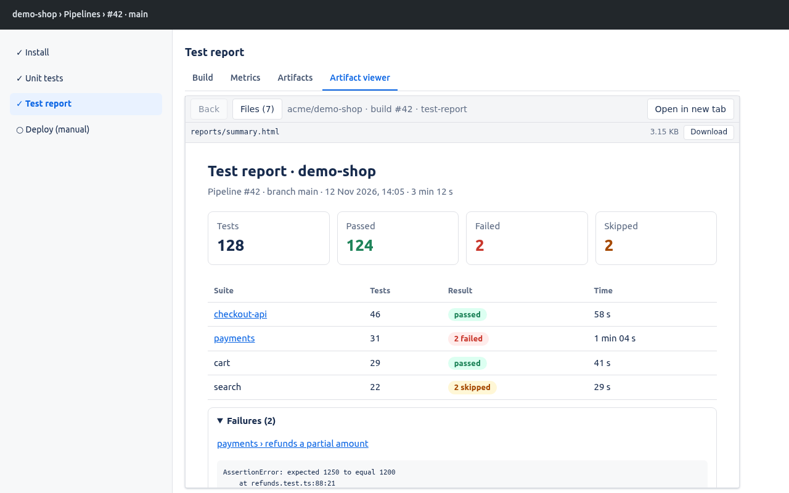
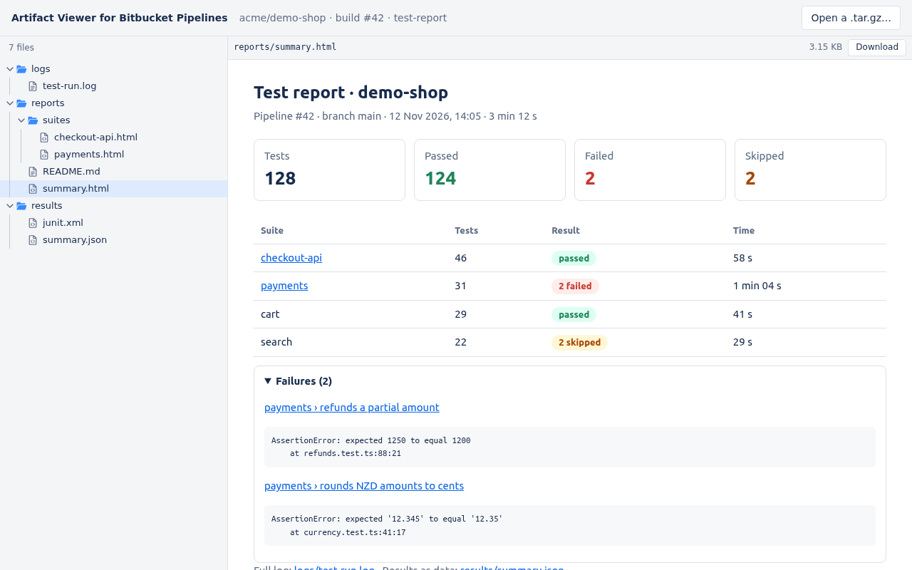

# Artifact Viewer for Bitbucket Pipelines

A Chrome extension that shows a Bitbucket Pipelines artifact right on the pipeline page. You no longer download the
`.tar.gz`, unpack it and look for the right HTML file.



## What it does

- **An Artifact viewer tab** sits next to Build, Metrics and Artifacts on a pipeline step and shows the step's artifact
  under the tabs. The viewer also opens in a tab of its own, and it opens a downloaded `.tar.gz` from your disk.
- **Every kind of file in an artifact:**
  - HTML reports, with their own stylesheets, images and fonts, and working links between their pages;
  - JUnit XML as a test report;
  - Markdown as a page;
  - formatted JSON and JSON Lines, and any text file;
  - images and video;
  - PDF in Chrome's PDF viewer.
- **A folder tree** of the artifact's files, and a Download button for any single file.
- **Everything stays in your browser.** The artifact is downloaded with your Bitbucket session, unpacked in memory,
  and gone when you close the tab.



## Install

- **Chrome Web Store:** coming soon.
- **From the source:**
  1. Clone this repository.
  2. Open `chrome://extensions`, turn on **Developer mode**, click **Load unpacked** and choose the `extension`
     folder.

  The bitbucket.org tabs that are already open get the Artifact viewer tab without a reload.

How to use it, what each kind of file shows as, the limits and what to do when something goes wrong:
[extension/README.md](extension/README.md).

## Security and privacy

An artifact comes from a pipeline, so the viewer treats its content as untrusted:
- **A report runs nothing.** It renders in a sandboxed frame with scripts, forms and pop-ups switched off.
- **A report reaches no network.** A content security policy blocks every request from it, and frames and plug-ins
  inside it are removed. A link to a website opens in a new tab only when you click it.
- **Files show as what their bytes are.** A file named `.png` or `.pdf` that holds something else is never handed to
  Chrome as one.
- **Your credentials stay with the browser.** The extension never reads, stores or sends a password, token or cookie.
  Nothing is sent to the developer or anyone else.

| Permission | Why |
|---|---|
| `https://bitbucket.org/*` | Adds the Artifact viewer tab, and downloads a build's artifact list and artifact through the open Bitbucket tab, with your session. |
| `webRequest` | Observes, without blocking or changing anything, where Bitbucket redirects the extension's own downloads, so that the viewer can name the storage host. |
| `scripting` | When the extension is installed or updated, adds its own scripts to the bitbucket.org tabs that are already open. |
| `https://*/*` (optional) | Requested only after you click **Allow and retry**, for the one storage host a download is redirected to. |

The privacy policy is in [PRIVACY.md](PRIVACY.md). To report a security problem, open an
[issue](https://github.com/buisonhoang06-pixel/bitbucket-artifact-viewer/issues) without the details and ask for a
private channel.

## Development

The extension has no build step and no runtime dependencies: Chrome loads the `extension` folder as it is.

You need:
- Node.js 22 or later;
- GNU tar, Python 3 and OpenSSL, for the tests;
- ffmpeg, for the store images.

```sh
npm ci
npx playwright install chromium

npm test                          # unit tests
npm run test:e2e                  # end-to-end tests: headless Chromium against a fake bitbucket.org
npm run package                   # release/bitbucket-artifact-viewer-<version>.zip and -store.zip
node store/make-store-assets.mjs  # the Chrome Web Store images and the reviewers' sample artifact
```

`EXTENSION_DIR=<folder> npm run test:e2e` runs the end-to-end tests against another copy, such as an unzipped
release.

The repository:
- `extension/` — the extension:
  - `manifest.json`;
  - `background.js`;
  - the content scripts `content.js` and `content-fetch.js`;
  - the viewer `viewer.html`, `viewer.js` and `viewer.css`;
  - `lib/`, with the archive reader, file kinds, Markdown, JUnit, rendering, links and the folder tree.
- `tests/` — `unit/`, `e2e/` (a fake bitbucket.org and pipeline step page), `helpers/` and `fixtures/`.
- `store/` — the Chrome Web Store listing text, its images, and the sample artifact for reviewers.
- `scripts/package.sh` — builds the release zips.

## Support

The extension is free and open source. If it saves you time, you can support its development on Ko-fi:

[](https://ko-fi.com/hoangbuison)

## License

[MIT](LICENSE).

Not affiliated with or endorsed by Atlassian. Bitbucket is a trademark of Atlassian.
